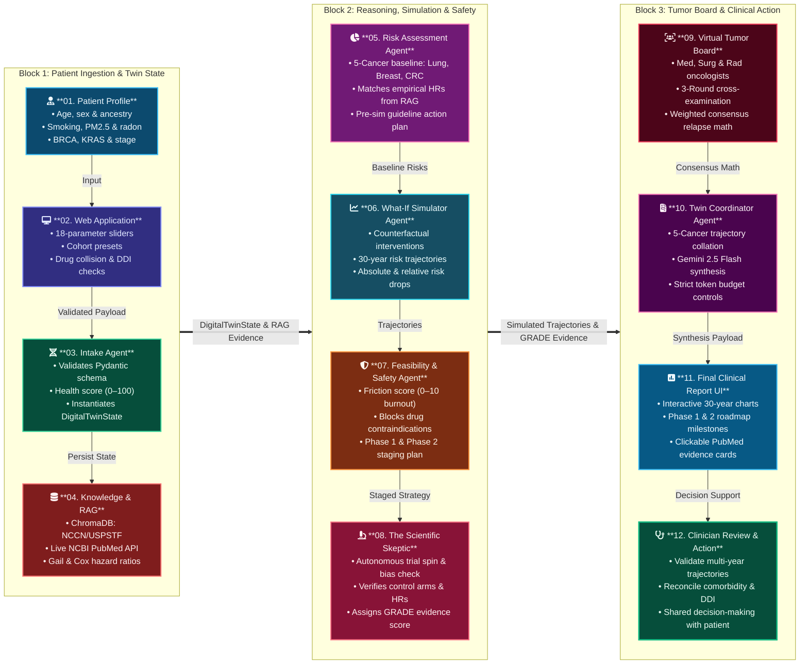

# CancerTwin AI 2.0 — Architecture Map & System Specification

> [!NOTE]
> **Complete Architecture Atlas**: This document provides the full structural and behavioral specification of **CancerTwin AI 2.0**. It incorporates an **Enterprise Slide Architecture Diagram** (matching presentation slide layouts), a **Colorful C4 Container Diagram** mapping the entire system hierarchy, followed by **four standalone, colorful flowcharts** dedicated to each core clinical pipeline:
> 1. **Enterprise Architecture Diagram (Slide-Ready End-to-End Flow)**
> 2. **C4 Container Diagram (Full System Hierarchy)**
> 3. **Primary Prevention & What-If Simulation Pipeline** (`prevention_graph.py`)
> 4. **Virtual Tumor Board 3-Round Cyclical Debate** (`tumor_board_graph.py`)
> 5. **Seed-and-Soil Metastasis Tracker** (`metastasis_tracker.py`)
> 6. **Pharmacology & Toxicity Simulation Engine** (`pharmacology_engine.py`)

---

## 1. Executive System Profile

| Specification | Technical Implementation |
| :--- | :--- |
| **Platform Name** | CancerTwin AI (v2.0) |
| **Clinical Mission** | Agentic Oncology Digital Twin for 5-Cancer Risk Prevention, Virtual Tumor Board Relapse Adjudication & What-If Simulation |
| **Backend & Runtime** | Python 3.10 • FastAPI • Uvicorn • Pydantic v2 |
| **Agent Orchestration** | LangGraph (`StateGraph`, Cyclical Specialist Debates, Deterministic Prevention DAG) |
| **Vector Database & RAG** | ChromaDB (`PersistentClient`) with Resilient Local JSON Fallback Store |
| **Knowledge Corpus** | 100+ Curated Guidelines (USPSTF, NCCN, WCRF, IARC, PubMed Phase 3 Trials) |
| **LLM & Inference** | Google Gemini (`v1beta` REST API) with strict input/output token budgeting |
| **Live Medical Literature** | NCBI PubMed E-Utilities REST API (`esearch`, `esummary`) & Rare Variant Cache |
| **External Agent Protocol** | Model Context Protocol (MCP) JSON-RPC 2.0 stdio Server |
| **Client Interface** | Vanilla JavaScript SPA, HTML5 Canvas 2D Trajectories, Neon SVG Health Gauges |

---

## 2. Enterprise Architecture Diagram (Card-Based End-to-End Flow)

> [!TIP]
> **Slide-Ready Architecture**: This diagram matches the enterprise presentation slide structure ([architecture_slide.html](file:///c:/Users/akash/Desktop/ClaudeProject/architecture_slide.html)), tracking data flow horizontally through card tiers from patient intake to multi-agent reasoning, RAG evidence grounding, and oncologist clinical review.

---

## 3. Colorful C4 Container Diagram (Full System Hierarchy)

```mermaid
graph TB
    %% Styling Classes
    classDef clientTier fill:#0c4a6e,stroke:#38bdf8,stroke-width:2.5px,color:#f0f9ff;
    classDef gatewayTier fill:#312e81,stroke:#818cf8,stroke-width:2.5px,color:#e0e7ff;
    classDef graphTier fill:#701a75,stroke:#f472b6,stroke-width:2.5px,color:#fdf2f8;
    classDef agentTier fill:#1e1b4b,stroke:#a855f7,stroke-width:2px,color:#faf5ff;
    classDef engineTier fill:#78350f,stroke:#fbbf24,stroke-width:2.5px,color:#fffbeb;
    classDef dataTier fill:#064e3b,stroke:#34d399,stroke-width:2.5px,color:#ecfdf5;
    classDef extTier fill:#881337,stroke:#fb7185,stroke-width:2.5px,color:#fff1f2;

    %% 1. PRESENTATION TIER
    subgraph Presentation_Tier ["🌐 1. Client & Presentation Tier"]
        WEB_SPA["fa:fa-desktop **Web Single-Page App (SPA)**<br/>[web/index.html • web/app.js]<br/>• 18-Parameter Twin Carousel<br/>• HTML5 Canvas 2D Trajectories<br/>• SVG Circular Health Gauges"]:::clientTier
        MCP_CLIENTS["fa:fa-terminal **External AI Desktop Clients**<br/>[Claude Desktop / Cursor IDE]<br/>• Model Context Protocol (stdio JSON-RPC)"]:::clientTier
    end

    %% 2. API & PROTOCOL GATEWAY TIER
    subgraph Gateway_Tier ["⚡ 2. API & Communication Gateway Tier"]
        FASTAPI_APP["fa:fa-bolt **FastAPI REST Application**<br/>[src/api/app.py • Python 3.10]<br/>• CORS Middleware & Static Mount (/static)<br/>• Pydantic v2 Schema Validation"]:::gatewayTier
        MCP_SERVER["fa:fa-network-wired **Model Context Protocol Server**<br/>[mcp_server.py • JSON-RPC stdio]<br/>• 5 High-Impact Clinical Tools<br/>• Guideline Catalog (cancertwin://)"]:::gatewayTier
    end

    %% 3. LANGGRAPH ORCHESTRATION TIER
    subgraph Orchestration_Tier ["🧠 3. Agentic Orchestration Tier (LangGraph)"]
        subgraph Prevention_DAG ["🧬 Digital Twin What-If Simulation Pipeline (5 Agents)"]
            AG_INTAKE["fa:fa-dna **1. Intake & Twin Profiler Agent**<br/>[intake_agent.py]<br/>Constructs DigitalTwinState & Health Score"]:::agentTier
            AG_RISK["fa:fa-chart-pie **2. Clinical Risk Assessment Agent**<br/>[risk_agent.py]<br/>5-Cancer Baseline Gail/Bach Models"]:::agentTier
            AG_SIM["fa:fa-sliders-h **3. What-If Simulator Agent**<br/>[simulation_agent.py]<br/>10-30 Yr Divergence Trajectory Engine"]:::agentTier
            AG_FEAS["fa:fa-shield-alt **4. Feasibility & Safety Staging Agent**<br/>[clinical_feasibility_agent.py]<br/>Comorbidity Audit & Friction Staging"]:::agentTier
            AG_COORD["fa:fa-project-diagram **5. Twin Coordinator Orchestrator Agent**<br/>[coordinator.py]<br/>Synthesizes Holistic Digital Twin Report"]:::agentTier

            AG_INTAKE --> AG_RISK --> AG_SIM --> AG_FEAS --> AG_COORD
        end

        subgraph Tumor_Board_Graph ["🩺 Virtual Tumor Board Debate (src/graphs/tumor_board_graph.py)"]
            TB_MED["fa:fa-pills **Medical Oncologist**<br/>[medical_oncologist.py]<br/>Systemic Regimens & ctDNA"]:::agentTier
            TB_SURG["fa:fa-cut **Surgical Oncologist**<br/>[surgical_oncologist.py]<br/>Resection Margins R0/R1/R2"]:::agentTier
            TB_RAD["fa:fa-radiation **Radiation Oncologist**<br/>[radiation_oncologist.py]<br/>Field Bed Sterilization"]:::agentTier
            TB_APPRAISE["fa:fa-microscope **Trial Appraisal Agent**<br/>[trial_appraisal_agent.py]<br/>The Scientific Skeptic"]:::agentTier
            TB_SUP["fa:fa-gavel **Supervisor Agent**<br/>[supervisor.py]<br/>Consensus Relapse Adjudication"]:::agentTier

            TB_MED --> TB_APPRAISE
            TB_SURG --> TB_APPRAISE
            TB_RAD --> TB_APPRAISE
            TB_APPRAISE --> TB_SUP
        end
    end

    %% 4. SPECIALIZED ENGINES TIER
    subgraph Engine_Tier ["⚙️ 4. Specialized Analytical & Algorithmic Engines"]
        ENG_MET["fa:fa-route **Metastasis Tracker Engine**<br/>[src/utils/metastasis_tracker.py]<br/>• Seed-and-Soil Affinity Matrix<br/>• Vascular & Lymphatic Route Mapping"]:::engineTier
        ENG_PHARM["fa:fa-heartbeat **Pharmacology & Toxicity Engine**<br/>[src/utils/pharmacology_engine.py]<br/>• 5-Year Relapse-Free Survival Curves<br/>• CYP450 Drug Collisions (3A4/2D6)"]:::engineTier
        ENG_RISK["fa:fa-calculator **Parametric Risk Calculators**<br/>[src/utils/risk_calculators.py]<br/>• Gail, Bach/USPSTF, WCRF Models"]:::engineTier
        TOOL_PUBMED["fa:fa-book-medical **PubMed Literature Tool**<br/>[src/tools/pubmed_tool.py]<br/>• Rare Variant Catalog (BRAF, KRAS, NTRK)"]:::engineTier
        TOOL_SAFETY["fa:fa-exclamation-triangle **Contraindication Tool**<br/>[src/tools/contraindication_tool.py]<br/>• Comorbidity Safety Checker"]:::engineTier
    end

    %% 5. DATA PERSISTENCE & RAG TIER
    subgraph Data_Tier ["🗄️ 5. Evidence RAG & Vector Persistence Tier"]
        CHROMA_DB[("fa:fa-database **ChromaDB Vector Store**<br/>[data/chromadb/]<br/>• PersistentClient Collection<br/>• Cosine Vector Search")]:::dataTier
        FALLBACK_STORE[("fa:fa-file-code **Resilient Fallback Store**<br/>[fallback_store.json]<br/>• In-Memory Keyword Search")]:::dataTier
        RAG_RETRIEVER["fa:fa-search **Oncology Retriever**<br/>[src/rag/retriever.py]<br/>• Metadata Filters & Top-K Retrieval"]:::dataTier
        RAW_GUIDELINES["fa:fa-folder-open **100+ Guideline Dataset**<br/>[data/raw_guidelines/*.json]<br/>• USPSTF, NCCN, WCRF, IARC, PubMed Trials"]:::dataTier
    end

    %% 6. EXTERNAL CLOUD SERVICES TIER
    subgraph External_Tier ["☁️ 6. External Cloud & Literature Services Tier"]
        EXT_GEMINI["fa:fa-robot **Google Gemini Generative AI**<br/>[generativelanguage.googleapis.com]<br/>• Gemini Flash / Pro REST API<br/>• Token Budgeting (In: 2048, Out: 1024)"]:::extTier
        EXT_PUBMED["fa:fa-university **NCBI PubMed E-Utilities API**<br/>[eutils.ncbi.nlm.nih.gov]<br/>• esearch.fcgi & esummary.fcgi"]:::extTier
    end

    %% CONNECTIONS
    WEB_SPA -->|"HTTP / REST API"| FASTAPI_APP
    MCP_CLIENTS -->|"JSON-RPC 2.0"| MCP_SERVER

    FASTAPI_APP -->|"Executes /api/twin/simulate"| AG_INTAKE
    FASTAPI_APP -->|"Executes /api/twin/relapse"| TB_MED
    FASTAPI_APP -->|"Executes /api/twin/metastasis"| ENG_MET
    FASTAPI_APP -->|"Executes /api/twin/therapeutic-simulate"| ENG_PHARM
    FASTAPI_APP -->|"Executes /api/rag/search"| RAG_RETRIEVER

    MCP_SERVER -->|"Dispatches Tools"| AG_INTAKE
    MCP_SERVER -->|"Dispatches Tools"| TB_MED
    MCP_SERVER -->|"Live Search"| TOOL_PUBMED

    AG_RISK -->|"Calculates Baseline"| ENG_RISK
    AG_RISK -->|"Retrieves Evidence"| RAG_RETRIEVER
    AG_SIM -->|"Grounded Trajectories"| RAG_RETRIEVER
    AG_FEAS -->|"Audits Contraindications"| TOOL_SAFETY
    AG_COORD -->|"Synthesizes Narrative"| EXT_GEMINI

    TB_MED -->|"Cites Evidence"| RAG_RETRIEVER
    TB_SURG -->|"Margin Guidelines"| RAG_RETRIEVER
    TB_RAD -->|"Field Sterilization"| RAG_RETRIEVER
    TB_APPRAISE -->|"Grounds Quotes"| TOOL_PUBMED
    TB_SUP -->|"Synthesizes Consensus"| EXT_GEMINI

    TOOL_PUBMED -->|"Fetches Abstracts"| EXT_PUBMED
    RAG_RETRIEVER -->|"Embeddings & Docs"| CHROMA_DB
    RAG_RETRIEVER -.->|"Memory Fallback"| FALLBACK_STORE
```

---

## 4. Flowchart 1: Prevention & What-If Simulation Pipeline (`prevention_graph.py`)

This flowchart details the **POST `/api/twin/simulate`** journey from intake to 30-year counterfactual curves and clinical safety staging.

```mermaid
flowchart TD
    %% Styling Classes
    classDef startEnd fill:#1e1b4b,stroke:#818cf8,stroke-width:3px,color:#f8fafc;
    classDef processBlock fill:#0f172a,stroke:#38bdf8,stroke-width:2px,color:#f8fafc;
    classDef decisionDiamond fill:#701a75,stroke:#f472b6,stroke-width:2.5px,color:#fdf2f8;
    classDef storageBlock fill:#064e3b,stroke:#34d399,stroke-width:2px,color:#ecfdf5;
    classDef externalBlock fill:#881337,stroke:#fb7185,stroke-width:2px,color:#fff1f2;
    classDef errorBlock fill:#450a0a,stroke:#ef4444,stroke-width:2px,color:#fef2f2;

    START_NODE(["fa:fa-play-circle **User Initiates Simulation**<br/>POST /api/twin/simulate (Web UI / REST API)"]):::startEnd
    
    VAL_PAYLOAD["fa:fa-clipboard-check **Validate Request Payload**<br/>Pydantic: PatientProfile & SimulationRequest"]:::processBlock
    
    CHECK_VAL{"fa:fa-question-circle **Is Payload<br/>Schema Valid?**"}:::decisionDiamond
    
    ERR_400["fa:fa-times-circle **Return HTTP 400 Bad Request**<br/>Detailed Pydantic ValidationError Schema"]:::errorBlock
    
    INIT_GRAPH["fa:fa-cogs **Initialize LangGraph Prevention State**<br/>PreventionSimulationState & AgentTraceLog"]:::processBlock
    
    %% Node 1: Intake
    STEP_INTAKE["fa:fa-id-card **1. Intake & Profiler Node** [intake_agent.py]<br/>• Normalize Demographics, BMI, Pack-Years<br/>• Calculate Overall Baseline Health Score (0-100)<br/>• Identify Primary Organ Vulnerabilities"]:::processBlock
    
    %% Node 2: Risk Assessment
    STEP_RISK["fa:fa-chart-bar **2. Clinical Risk Assessment Node** [risk_agent.py]<br/>• Calculate Gail, Bach, WCRF Risk Scores<br/>• Query Evidence Knowledge Base for 5-Cancer Hazard Ratios"]:::processBlock
    
    CHECK_CHROMA{"fa:fa-database **Is ChromaDB<br/>Vector Store Online?**"}:::decisionDiamond
    
    QUERY_CHROMA[("fa:fa-search **ChromaDB Semantic Vector Search**<br/>Cosine Distance Indexing + Cancer Metadata Filters")]:::storageBlock
    
    QUERY_FALLBACK[("fa:fa-file-alt **Fallback Keyword & Scoring Search**<br/>In-Memory Scan of fallback_store.json")]:::storageBlock
    
    GEN_PRE_RECS["fa:fa-stethoscope **Generate Pre-Simulation Action Items**<br/>Immediate USPSTF Screening & Vaccination Guidance"]:::processBlock
    
    %% Node 3: What-If Simulation
    STEP_SIM["fa:fa-sliders-h **3. What-If Counterfactual Simulation Node** [simulation_agent.py]<br/>Apply Intervention Levers Across 5 Cancers"]:::processBlock
    
    CHECK_CUSTOM_SCENARIO{"fa:fa-filter **Did User Specify<br/>Custom Levers?**"}:::decisionDiamond
    
    APPLY_CUSTOM["fa:fa-edit **Apply Custom Intervention Parameters**<br/>Target BMI, Smoking Stop, Fiber, Exercise, Screenings"]:::processBlock
    
    APPLY_DEFAULTS["fa:fa-magic **Apply Standard Optimization Defaults**<br/>Guideline-Directed Multimodal Preventive Plan"]:::processBlock
    
    CALC_TRAJECTORIES["fa:fa-chart-line **Compute 10 to 30-Year Trajectory Curves**<br/>• Annual Baseline vs. Counterfactual Absolute Risk %<br/>• Compute Relative Risk Reduction (RRR) & Absolute Delta"]:::processBlock
    
    %% Node 4: Safety & Feasibility
    STEP_FEAS["fa:fa-shield-alt **4. Clinical Feasibility & Safety Audit Node** [clinical_feasibility_agent.py]<br/>Cross-examine Interventions with Patient Comorbidities"]:::processBlock
    
    CHECK_CONTRAINDICATIONS{"fa:fa-exclamation-triangle **Are Proposed Levers<br/>Contraindicated?**"}:::decisionDiamond
    
    FLAG_SAFETY["fa:fa-shield-virus **Append Safety Warnings & Adapt Plan**<br/>e.g., Omit high-impact exercise if arthritic; flag NSAID risks"]:::processBlock
    
    STAGE_PHASES["fa:fa-calendar-alt **Stage Preventive Interventions Chronologically**<br/>• Phase 1: High-Yield Priority Levers (Months 1–6)<br/>• Phase 2: Consolidation & Lifestyle Habituation (Months 6–12)"]:::processBlock
    
    %% Node 5: Synthesis
    STEP_COORD["fa:fa-brain **5. Coordinator Synthesis Node** [coordinator.py]<br/>Aggregate 5-Cancer Projections, Trace Logs & Guideline Citations"]:::processBlock
    
    CHECK_LLM_KEY{"fa:fa-key **Is Valid Gemini<br/>API Key Present?**"}:::decisionDiamond
    
    CALL_GEMINI["fa:fa-robot **Dispatch Google Gemini REST Generation**<br/>• Enforce Strict Token Budget (Input: 2048, Output: 1024)<br/>• Ground Clinical Narrative in Cited Guidelines & HRs"]:::externalBlock
    
    GEN_TEMPLATE["fa:fa-file-invoice **Synthesize Deterministic Clinical Narrative**<br/>Rule-Based Expert System Template"]:::processBlock
    
    BUILD_REPORT["fa:fa-box **Compile Final Comprehensive RiskReport**<br/>• Digital Twin ID, Health Score & Trajectories<br/>• Feasibility Audit, Citations & Agent Trace Logs"]:::processBlock
    
    END_RESPONSE(["fa:fa-check-circle **Return HTTP 200 OK with RiskReport**<br/>Render Interactive Canvas Curves & Logs on Client"]):::startEnd

    %% FLOWCHART WIRING
    START_NODE --> VAL_PAYLOAD
    VAL_PAYLOAD --> CHECK_VAL
    CHECK_VAL -->|No: Invalid Payload| ERR_400
    CHECK_VAL -->|Yes: Valid Schema| INIT_GRAPH
    
    INIT_GRAPH --> STEP_INTAKE
    STEP_INTAKE --> STEP_RISK
    
    STEP_RISK --> CHECK_CHROMA
    CHECK_CHROMA -->|Online| QUERY_CHROMA
    CHECK_CHROMA -->|Offline / Unavailable| QUERY_FALLBACK
    QUERY_CHROMA --> GEN_PRE_RECS
    QUERY_FALLBACK --> GEN_PRE_RECS
    
    GEN_PRE_RECS --> STEP_SIM
    STEP_SIM --> CHECK_CUSTOM_SCENARIO
    CHECK_CUSTOM_SCENARIO -->|Yes: User Input| APPLY_CUSTOM
    CHECK_CUSTOM_SCENARIO -->|No: Unspecified| APPLY_DEFAULTS
    APPLY_CUSTOM --> CALC_TRAJECTORIES
    APPLY_DEFAULTS --> CALC_TRAJECTORIES
    
    CALC_TRAJECTORIES --> STEP_FEAS
    STEP_FEAS --> CHECK_CONTRAINDICATIONS
    CHECK_CONTRAINDICATIONS -->|Yes: Conflicts Detected| FLAG_SAFETY
    CHECK_CONTRAINDICATIONS -->|No: Clinically Safe| STAGE_PHASES
    FLAG_SAFETY --> STAGE_PHASES
    
    STAGE_PHASES --> STEP_COORD
    STEP_COORD --> CHECK_LLM_KEY
    CHECK_LLM_KEY -->|Key Active| CALL_GEMINI
    CHECK_LLM_KEY -->|Missing / Mock| GEN_TEMPLATE
    CALL_GEMINI --> BUILD_REPORT
    GEN_TEMPLATE --> BUILD_REPORT
    
    BUILD_REPORT --> END_RESPONSE
```

---

## 5. Flowchart 2: Virtual Tumor Board 3-Round Cyclical Debate (`tumor_board_graph.py`)

This flowchart details the **POST `/api/twin/relapse`** journey. Three oncologist agents debate adjuvant management, cross-examined by the Scientific Skeptic appraisal agent, before the Supervisor adjudicates consensus.

```mermaid
flowchart TD
    %% Styling Classes
    classDef startEnd fill:#1e1b4b,stroke:#818cf8,stroke-width:3px,color:#f8fafc;
    classDef processBlock fill:#0f172a,stroke:#38bdf8,stroke-width:2px,color:#f8fafc;
    classDef decisionDiamond fill:#701a75,stroke:#f472b6,stroke-width:2.5px,color:#fdf2f8;
    classDef storageBlock fill:#064e3b,stroke:#34d399,stroke-width:2px,color:#ecfdf5;
    classDef externalBlock fill:#881337,stroke:#fb7185,stroke-width:2px,color:#fff1f2;
    classDef errorBlock fill:#450a0a,stroke:#ef4444,stroke-width:2px,color:#fef2f2;

    TB_START(["fa:fa-play-circle **Initiate Virtual Tumor Board Debate**<br/>POST /api/twin/relapse (PriorCancerHistory)"]):::startEnd

    VAL_HISTORY["fa:fa-clipboard-list **Validate Oncology History**<br/>Primary cancer, stage, margins, ctDNA status, biomarkers"]:::processBlock

    CHECK_PRIOR{"fa:fa-question-circle **Has Prior Cancer<br/>Flag Set to True?**"}:::decisionDiamond

    ERR_NO_CANCER["fa:fa-times-circle **Return HTTP 400 Bad Request**<br/>'Prior cancer history is required'"]:::errorBlock

    INIT_TB_STATE["fa:fa-cogs **Initialize TumorBoardDebateState**<br/>Set round_number = 1, initialize transcript & trace lists"]:::processBlock

    %% Round 1: Opening Assessments
    subgraph Round1 ["Round 1: Opening Specialist Assessments"]
        NODE_MED["fa:fa-pills **Medical Oncology Assessment**<br/>[medical_oncologist.py]<br/>• Evaluate systemic adjuvant chemotherapy<br/>• Check targeted TKIs & ctDNA/MRD status"]:::processBlock

        NODE_SURG["fa:fa-cut **Surgical Oncology Assessment**<br/>[surgical_oncologist.py]<br/>• Classify surgical margins (R0 vs. positive R1/R2)<br/>• Evaluate re-excision feasibility & lymph nodes"]:::processBlock

        NODE_RAD["fa:fa-radiation **Radiation Oncology Assessment**<br/>[radiation_oncologist.py]<br/>• Evaluate tumor bed sterilization (EBRT / SBRT)<br/>• Analyze antigen kinetics (PSA, CEA, CA-125)"]:::processBlock
    end

    %% Evidence Retrieval & Appraisal
    QUERY_EVIDENCE["fa:fa-search **ChromaDB Oncology Evidence Retrieval**<br/>Query relapse guidelines & clinical trials"]:::storageBlock

    CHECK_PUBMED_TRIAL{"fa:fa-question-circle **Does Evidence Contain<br/>Unreviewed PubMed Trial?**"}:::decisionDiamond

    NODE_APPRAISE["fa:fa-microscope **Trial Appraisal Node (The Scientific Skeptic)**<br/>[trial_appraisal_agent.py]<br/>• Audit trial phase & control arm validity<br/>• Detect publication spin & post-hoc subgroup bias<br/>• Ground hazard ratios with verbatim quote verification"]:::processBlock

    SET_ROUND_2["fa:fa-step-forward **Advance Debate to Round 2**<br/>round_number = 2 (Cross-Examination Rebuttal)"]:::processBlock

    %% Round 2: Rebuttal & Cross-Examination
    subgraph Round2 ["Round 2: Cyclical Rebuttal & Cross-Examination"]
        REBUTTAL_MED["fa:fa-exchange-alt **Medical Oncologist Rebuttal**<br/>Challenges surgical margin status or omission of radiation"]:::processBlock
        REBUTTAL_SURG["fa:fa-exchange-alt **Surgical Oncologist Rebuttal**<br/>Argues re-excision necessity vs. toxicity of salvage chemotherapy"]:::processBlock
        REBUTTAL_RAD["fa:fa-exchange-alt **Radiation Oncologist Rebuttal**<br/>Advocates stereotactic body radiotherapy (SBRT) boost"]:::processBlock
    end

    %% Round 3: Adjudication
    NODE_SUPERVISOR["fa:fa-gavel **Round 3: Tumor Board Supervisor Adjudication**<br/>[supervisor.py]<br/>• Reconcile conflicting opinions with guideline hierarchy<br/>• Calculate consensus relapse risk % score<br/>• Formulate authoritative multidisciplinary regimen"]:::processBlock

    CHECK_TB_LLM{"fa:fa-robot **Is Gemini LLM<br/>Key Active?**"}:::decisionDiamond

    CALL_TB_GEMINI["fa:fa-brain **Synthesize Consensus Executive Verdict**<br/>Generate physician-grade consensus narrative via Gemini"]:::externalBlock

    FALLBACK_TB_NARRATIVE["fa:fa-file-invoice **Generate Rule-Based Consensus Summary**<br/>Deterministic consensus template"]:::processBlock

    BUILD_TB_RESULT["fa:fa-check-double **Compile TumorBoardDebateResult**<br/>Consensus risk %, final regimen, full transcript & trial audit"]:::processBlock

    TB_END(["fa:fa-check-circle **Return HTTP 200 OK with TumorBoardDebateResult**<br/>Render 3-Round Interactive Transcript & Opinions in UI"]):::startEnd

    %% Flowchart Wiring
    TB_START --> VAL_HISTORY
    VAL_HISTORY --> CHECK_PRIOR
    CHECK_PRIOR -->|No| ERR_NO_CANCER
    CHECK_PRIOR -->|Yes| INIT_TB_STATE

    INIT_TB_STATE --> NODE_MED
    NODE_MED --> NODE_SURG
    NODE_SURG --> NODE_RAD
    NODE_RAD --> QUERY_EVIDENCE

    QUERY_EVIDENCE --> CHECK_PUBMED_TRIAL
    CHECK_PUBMED_TRIAL -->|Yes: Trial Found| NODE_APPRAISE
    CHECK_PUBMED_TRIAL -->|No: Standard Guidelines| SET_ROUND_2
    NODE_APPRAISE --> SET_ROUND_2

    SET_ROUND_2 --> REBUTTAL_MED
    REBUTTAL_MED --> REBUTTAL_SURG
    REBUTTAL_SURG --> REBUTTAL_RAD
    REBUTTAL_RAD --> NODE_SUPERVISOR

    NODE_SUPERVISOR --> CHECK_TB_LLM
    CHECK_TB_LLM -->|Yes| CALL_TB_GEMINI
    CHECK_TB_LLM -->|No / Mock| FALLBACK_TB_NARRATIVE
    CALL_TB_GEMINI --> BUILD_TB_RESULT
    FALLBACK_TB_NARRATIVE --> BUILD_TB_RESULT

    BUILD_TB_RESULT --> TB_END
```

---

## 6. Flowchart 3: Seed-and-Soil Metastasis Tracker (`metastasis_tracker.py`)

This flowchart details the **POST `/api/twin/metastasis`** journey, evaluating whether a newly discovered lesion is true traveling metastasis or a *de novo* second primary cancer.

```mermaid
flowchart TD
    %% Styling Classes
    classDef startEnd fill:#1e1b4b,stroke:#818cf8,stroke-width:3px,color:#f8fafc;
    classDef processBlock fill:#0f172a,stroke:#38bdf8,stroke-width:2px,color:#f8fafc;
    classDef decisionDiamond fill:#701a75,stroke:#f472b6,stroke-width:2.5px,color:#fdf2f8;
    classDef storageBlock fill:#064e3b,stroke:#34d399,stroke-width:2px,color:#ecfdf5;
    classDef externalBlock fill:#881337,stroke:#fb7185,stroke-width:2px,color:#fff1f2;
    classDef accentBlock fill:#78350f,stroke:#fbbf24,stroke-width:2px,color:#fffbeb;

    MET_START(["fa:fa-play-circle **Submit New Lesion for Metastasis Analysis**<br/>POST /api/twin/metastasis (MetastasisAnalysisRequest)"]):::startEnd

    PARSE_MET["fa:fa-clipboard-check **Parse Primary Cancer & New Lesion Site**<br/>Primary type, new anatomical site, interval months, biomarkers"]:::processBlock

    LOOKUP_ORGANOTROPISM["fa:fa-table **Query Seed-and-Soil Organotropism Matrix**<br/>Lookup baseline affinity score (e.g., CRC→Liver: 0.88, Prostate→Bone: 0.92)"]:::accentBlock

    TRACE_ROUTE["fa:fa-route **Trace Anatomical Vascular & Lymphatic Route**<br/>Identify biological travel pathway (Portal vein, Batson plexus, Thoracic duct)"]:::processBlock

    EVAL_INTERVAL["fa:fa-calendar-alt **Evaluate Disease-Free Latency Interval**<br/>Time from primary curative treatment to new lesion presentation"]:::processBlock

    CHECK_BIOMARKER_DATA{"fa:fa-dna **Are Biopsy Biomarkers<br/>Available?**"}:::decisionDiamond

    ANALYZE_CONCORDANCE["fa:fa-microscope **Analyze Clonal Biomarker Concordance**<br/>Compare CK7, CK20, TTF-1, PSA, GATA3, KRAS/BRAF mutations"]:::processBlock

    HEURISTIC_ESTIMATE["fa:fa-calculator **Apply Organotropism & Latency Prior**<br/>Estimate probability based on anatomy and time interval"]:::processBlock

    COMPUTE_PROBABILITY["fa:fa-percentage **Compute Traveling Metastasis Probability**<br/>Synthesize organotropism affinity + clonal concordance + latency"]:::processBlock

    CHECK_CLASSIFICATION{"fa:fa-balance-scale **Is Probability Score<br/>>= 50%?**"}:::decisionDiamond

    CLASS_METASTASIS["fa:fa-bullseye **Classify as Traveling Distant Metastasis**<br/>• Clonal relapse of original primary tumor<br/>• Direct systemic staging (PET/CT) & palliative/targeted therapy"]:::externalBlock

    CLASS_SECOND_PRIMARY["fa:fa-seedling **Classify as De Novo Second Primary**<br/>• Independent new oncogenic event<br/>• Recommend curative-intent biopsy and dedicated surgical workup"]:::processBlock

    BUILD_MET_RESPONSE["fa:fa-file-medical-alt **Compile MetastasisAnalysisResponse**<br/>Organotropism affinity, travel route description, probability %, and clinical directives"]:::processBlock

    MET_END(["fa:fa-check-circle **Return HTTP 200 OK with Metastasis Analysis**<br/>Render Clonal Pathway & Recommendation in UI"]):::startEnd

    %% Flowchart Wiring
    MET_START --> PARSE_MET
    PARSE_MET --> LOOKUP_ORGANOTROPISM
    LOOKUP_ORGANOTROPISM --> TRACE_ROUTE
    TRACE_ROUTE --> EVAL_INTERVAL
    EVAL_INTERVAL --> CHECK_BIOMARKER_DATA

    CHECK_BIOMARKER_DATA -->|Yes: Biopsy Done| ANALYZE_CONCORDANCE
    CHECK_BIOMARKER_DATA -->|No: Imaging Only| HEURISTIC_ESTIMATE

    ANALYZE_CONCORDANCE --> COMPUTE_PROBABILITY
    HEURISTIC_ESTIMATE --> COMPUTE_PROBABILITY

    COMPUTE_PROBABILITY --> CHECK_CLASSIFICATION
    CHECK_CLASSIFICATION -->|Probability >= 50%| CLASS_METASTASIS
    CHECK_CLASSIFICATION -->|Probability < 50%| CLASS_SECOND_PRIMARY

    CLASS_METASTASIS --> BUILD_MET_RESPONSE
    CLASS_SECOND_PRIMARY --> BUILD_MET_RESPONSE

    BUILD_MET_RESPONSE --> MET_END
```

---

## 7. Flowchart 4: Pharmacology & Toxicity Simulation Engine (`pharmacology_engine.py`)

This flowchart details the **POST `/api/twin/therapeutic-simulate`** journey, modeling 5-year Relapse-Free Survival trajectories and CYP450 drug-drug interactions.

```mermaid
flowchart TD
    %% Styling Classes
    classDef startEnd fill:#1e1b4b,stroke:#818cf8,stroke-width:3px,color:#f8fafc;
    classDef processBlock fill:#0f172a,stroke:#38bdf8,stroke-width:2px,color:#f8fafc;
    classDef decisionDiamond fill:#701a75,stroke:#f472b6,stroke-width:2.5px,color:#fdf2f8;
    classDef storageBlock fill:#064e3b,stroke:#34d399,stroke-width:2px,color:#ecfdf5;
    classDef externalBlock fill:#881337,stroke:#fb7185,stroke-width:2px,color:#fff1f2;
    classDef warningBlock fill:#78350f,stroke:#fbbf24,stroke-width:2px,color:#fffbeb;

    PHARM_START(["fa:fa-play-circle **Submit Therapeutic Regimen for Simulation**<br/>POST /api/twin/therapeutic-simulate (TherapeuticSimulationRequest)"]):::startEnd

    READ_PARAMS["fa:fa-clipboard-list **Read Patient Clinical & Regimen Levers**<br/>Stage, surgical margin (R0/R1/R2), re-excision flag, SBRT boost, ctDNA, systemic drug, home meds"]:::processBlock

    CALC_BASE_RELAPSE["fa:fa-calculator **Compute Baseline 5-Year Relapse Risk**<br/>Apply stage base + unsterilized margin multiplier + ctDNA positive multiplier"]:::processBlock

    %% Lever Adjustments
    CHECK_REEXCISION{"fa:fa-question-circle **Was Re-excision<br/>Performed?**"}:::decisionDiamond

    RESET_MARGIN["fa:fa-cut **Re-excision Sterilizes Surgical Margins**<br/>Resets margin multiplier to clear (1.0x)"]:::processBlock

    CHECK_SBRT{"fa:fa-radiation **Is Radiation SBRT<br/>Bed Boost Added?**"}:::decisionDiamond

    APPLY_SBRT["fa:fa-compress **Apply Radiation Bed Sterilization Factor**<br/>Reduces residual local margin relapse by 65%"]:::processBlock

    APPLY_SYSTEMIC["fa:fa-pills **Apply Systemic Therapy Hazard Ratio (HR)**<br/>Targeted TKI (HR 0.58), Chemotherapy (HR 0.72), Immunotherapy (HR 0.68)"]:::processBlock

    COMPUTE_SIM_RELAPSE["fa:fa-percentage **Compute Simulated Relapse Risk %**<br/>Derive absolute risk reduction (Baseline - Simulated)"]:::processBlock

    CALC_RFS_CURVE["fa:fa-chart-area **Compute 5-Year Relapse-Free Survival (RFS) Trajectory**<br/>Generate annual Kaplan-Meier style RFS % points for Years 1 through 5"]:::processBlock

    %% Drug-Drug Collision Check
    AUDIT_CYP450["fa:fa-flask **Audit CYP450 Pharmacokinetics & Home Medications**<br/>Cross-examine selected oncology regimen against current patient prescriptions"]:::processBlock

    CHECK_DDI{"fa:fa-exclamation-triangle **Are CYP3A4 / CYP2D6 / QTc<br/>Collisions Detected?**"}:::decisionDiamond

    GEN_DDI_ALERTS["fa:fa-shield-virus **Generate Critical Drug-Drug Interaction Alerts**<br/>• Flag enzyme inhibition/induction (CYP3A4/2D6)<br/>• Model QTc prolongation & bleeding toxicity hazard points"]:::warningBlock

    STANDARD_PROFILE["fa:fa-check **No Severe Metabolic Collisions Detected**<br/>Standard baseline pharmacologic toxicity profile"]:::processBlock

    BUILD_PHARM_RESPONSE["fa:fa-box **Compile TherapeuticSimulationResponse**<br/>Baseline vs. Simulated relapse %, 5-year RFS curve, toxicity hazard curve, and DDI alerts"]:::processBlock

    PHARM_END(["fa:fa-check-circle **Return HTTP 200 OK with Therapeutic Simulation**<br/>Render Interactive 5-Year Survival Curves & Toxicity Gauges in UI"]):::startEnd

    %% Flowchart Wiring
    PHARM_START --> READ_PARAMS
    READ_PARAMS --> CALC_BASE_RELAPSE

    CALC_BASE_RELAPSE --> CHECK_REEXCISION
    CHECK_REEXCISION -->|Yes| RESET_MARGIN
    CHECK_REEXCISION -->|No| CHECK_SBRT
    RESET_MARGIN --> CHECK_SBRT

    CHECK_SBRT -->|Yes| APPLY_SBRT
    CHECK_SBRT -->|No| APPLY_SYSTEMIC
    APPLY_SBRT --> APPLY_SYSTEMIC

    APPLY_SYSTEMIC --> COMPUTE_SIM_RELAPSE
    COMPUTE_SIM_RELAPSE --> CALC_RFS_CURVE
    CALC_RFS_CURVE --> AUDIT_CYP450

    AUDIT_CYP450 --> CHECK_DDI
    CHECK_DDI -->|Yes: Collisions Found| GEN_DDI_ALERTS
    CHECK_DDI -->|No: Safe Combination| STANDARD_PROFILE

    GEN_DDI_ALERTS --> BUILD_PHARM_RESPONSE
    STANDARD_PROFILE --> BUILD_PHARM_RESPONSE

    BUILD_PHARM_RESPONSE --> PHARM_END
```

---

## 7. Complete Architectural Matrix Summary

| Workflow / Subsystem | Primary Script | Architecture Diagram | Key Outputs |
| :--- | :--- | :--- | :--- |
| **System Hierarchy** | Entire Project | **Diagram 1: C4 Container** | Multi-tier static topology, client-to-cloud connections |
| **Primary Prevention** | `src/graphs/prevention_graph.py` | **Diagram 2: Flowchart 1** | Digital twin health score, 5-cancer risks, 30-yr curves |
| **Tumor Board Debate** | `src/graphs/tumor_board_graph.py` | **Diagram 3: Flowchart 2** | 3-round debate transcript, consensus relapse risk, trial audit |
| **Metastasis Tracker** | `src/utils/metastasis_tracker.py` | **Diagram 4: Flowchart 3** | Organotropism score, vascular route, clonal metastasis % |
| **Pharmacology Engine**| `src/utils/pharmacology_engine.py`| **Diagram 5: Flowchart 4** | 5-year RFS curve, CYP450 DDI alerts, toxicity hazard points |
| **MCP Server** | `mcp_server.py` | Integrated in C4 Tier 2 | stdio JSON-RPC tools for Claude Desktop / Cursor IDE |
